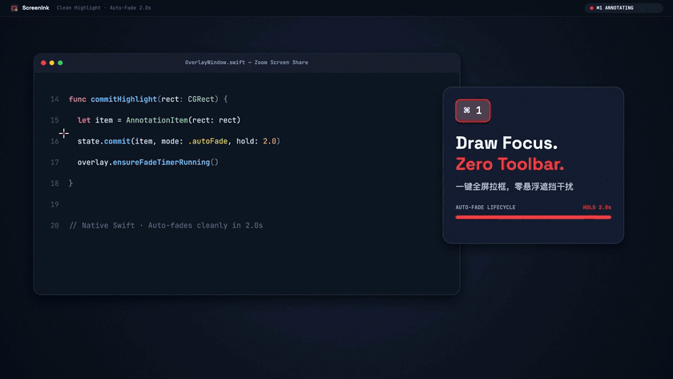
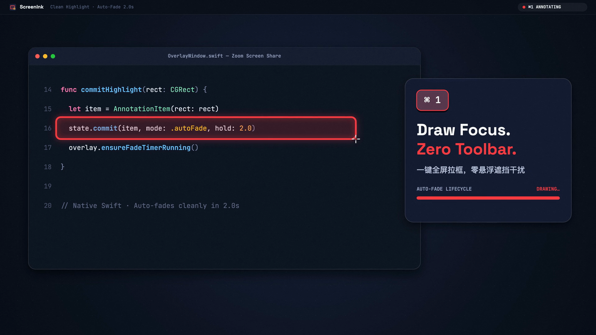
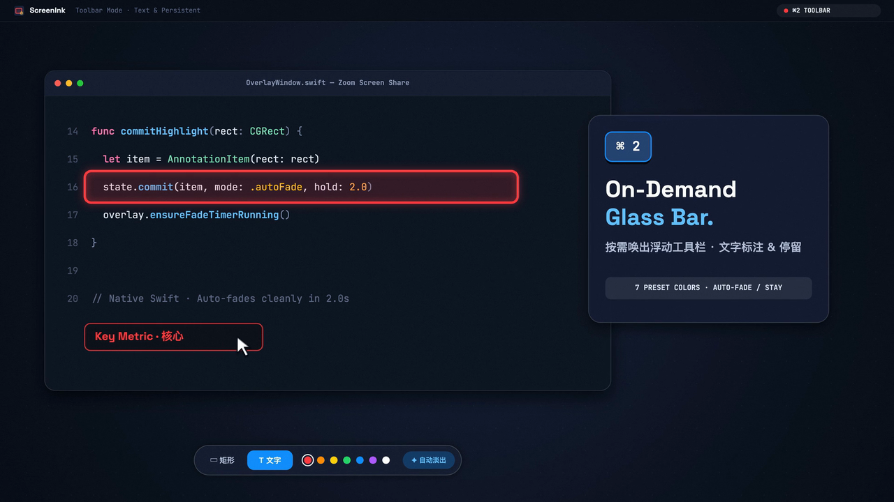
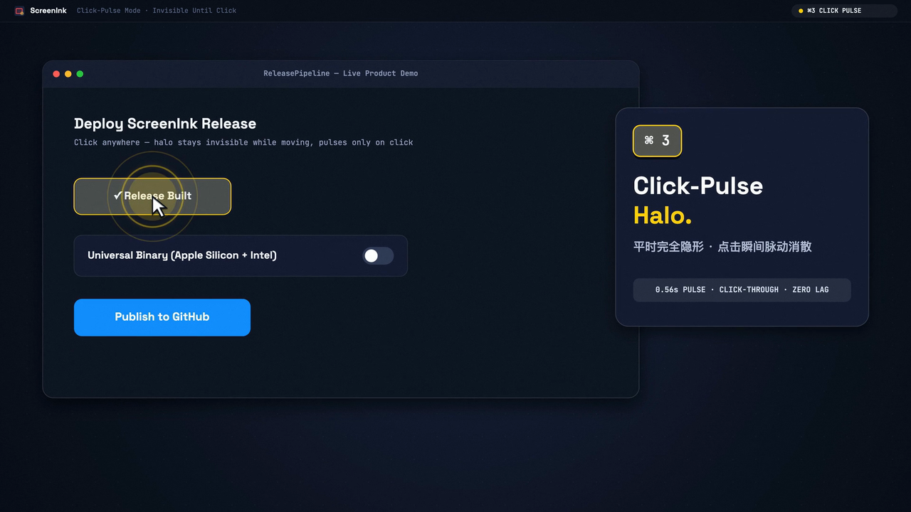
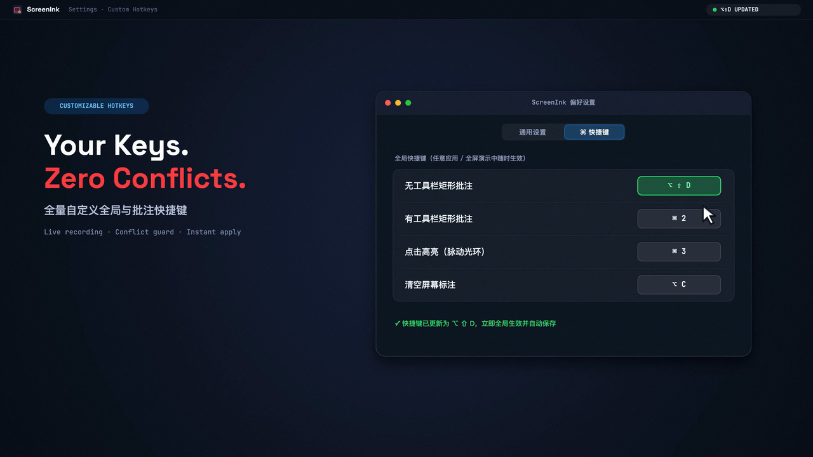

# ScreenInk

[](https://github.com/zhucl1006/ScreenInk/actions/workflows/build-and-release.yml)
[](https://github.com/zhucl1006/ScreenInk/releases/latest)
[-blue)](#下载与安装)
[](LICENSE)

> **专为在线会议、代码讲解、产品演示打造的极简原生 macOS 屏幕高亮标注与点击光环工具。**
>
> *A lightweight, distraction-free native macOS screen highlighter & click-pulse overlay built with Swift, AppKit, and SwiftUI.*

---

## 产品演示（40 秒速览）

<p align="center">
  <a href="https://github.com/zhucl1006/ScreenInk/raw/main/docs/media/screenink-demo.mp4" title="点击观看/下载 40 秒完整带声演示视频">
    
  </a>
</p>

<p align="center">
  <a href="https://github.com/zhucl1006/ScreenInk/raw/main/docs/media/screenink-demo.mp4"><strong>▶ 观看 / 下载完整 40 秒高清带声演示视频（MP4）</strong></a>
  &nbsp;·&nbsp;
  <a href="https://github.com/zhucl1006/ScreenInk/releases/latest"><strong>⬇ 前往 Releases 下载最新版本（DMG / ZIP）</strong></a>
</p>

---

## 这是什么？为什么做它？

开会共享屏幕（Zoom / 腾讯会议 / 飞书 / Teams / Google Meet）或做产品/代码演示时，你是不是经常遇到这些痛点：

- 口头说“看屏幕左边第三个按钮、往下两行那个字段”，听众还是找不到你在指哪里；
- 传统的屏幕画笔软件界面太重、工具栏一大堆、画完还得手动点橡皮擦或清屏；
- 只是想快速框一下重点，或者让观众看清自己点击了哪里，不想在共享画面里露出一堆复杂的悬浮面板。

**ScreenInk** 就是为解决这个单一场景而生的极致轻量工具：

- **零干扰**：常驻顶部菜单栏、不占 Dock 图标；按 **`⌘1`** 直接全屏透明画高亮框，**不弹出任何工具栏**。
- **自动淡出（默认）**：圈完重点后停留 2 秒自动平滑消失，继续讲下一页完全不用手动清屏（也支持一键切换为**停留模式**并手动清除）。
- **点击脉动光环**：按 **`⌘3`** 开启点击高亮，平时完全隐形不挡视线，每次鼠标点击时在点击位置弹出柔和脉动光环后自动消失，观众一眼看清操作路径。
- **纯原生、极轻量、免辅助功能权限**：Swift + AppKit + CoreGraphics 原生编写，安装包仅 ~1.5 MB，无需繁琐的系统辅助功能授权，直接覆盖全屏 Keynote、浏览器、IDE 和多显示器。

---

## 核心功能

| 功能 | 说明 |
| --- | --- |
| **无工具栏批注 (`⌘1`)** | 默认启动方式：无任何悬浮面板干扰，拉一下立刻画出圆角发光高亮矩形（按住 `Shift` 画正方形） |
| **有工具栏批注 (`⌘2`)** | 需要切换文字标注、颜色或停留模式时唤起极简毛玻璃浮动条，也可通过菜单栏随时开关 |
| **点击高亮 (`⌘3`)** | 平时隐形不遮挡鼠标；左/右键点击时原地弹出柔和光晕 + 脉动圆环 + 扩散涟漪，约 0.56 秒后自动消失，完全穿透不拦截点击 |
| **矩形 & 文字标注** | 只保留会议最常用的两种标注：发光圆角高亮矩形 + 带半透明深色底板的清晰文字标注（支持中英文输入法） |
| **自动淡出 / 停留模式** | 默认**自动淡出**（停留时长 `0.5s–8.0s` 可调）；也可切换为**停留模式**，退出批注后笔迹保留且鼠标穿透，随时 `⌥C` 一键清除 |
| **自由选色与偏好设置** | 7 种高频高亮预设色 + 系统任意取色器，支持自定义边框粗细、矩形内部淡色填充、光环大小/透明度与全量自定义快捷键，自动持久化保存 |

### 功能画面预览

<table>
  <tr>
    <td width="50%" align="center">
      
      <br />
      <sub><strong>无工具栏高亮 + 2 秒自动淡出（默认 <code>⌘1</code>）</strong></sub>
    </td>
    <td width="50%" align="center">
      
      <br />
      <sub><strong>按需浮动工具栏、文字标注与停留模式（默认 <code>⌘2</code>）</strong></sub>
    </td>
  </tr>
  <tr>
    <td width="50%" align="center">
      
      <br />
      <sub><strong>点击脉动光环：平时隐形，点击即亮（默认 <code>⌘3</code>）</strong></sub>
    </td>
    <td width="50%" align="center">
      
      <br />
      <sub><strong>偏好设置：全量自定义快捷键与冲突检测（<code>⌘,</code>）</strong></sub>
    </td>
  </tr>
</table>

---

## 下载与安装

支持 **macOS 13.0 (Ventura) 及以上版本**，提供 **Universal Binary（同时兼容 Apple Silicon M 系列与 Intel Mac）**。

### 方式一：直接下载最新版本（推荐）

1. 前往 **[Releases 最新版本页面](https://github.com/zhucl1006/ScreenInk/releases/latest)**，下载：
   - **`ScreenInk-macOS.dmg`**（推荐，双击后拖拽安装）
   - 或 **`ScreenInk-macOS.zip`**（解压即用）
2. 打开 `.dmg`，将 **`ScreenInk.app`** 拖入 `Applications`（应用程序）文件夹。
3. 从启动台或应用程序目录打开 **ScreenInk**，屏幕顶部菜单栏会出现高亮框图标，说明已启动就绪。

> **关于首次打开的安全提示（Gatekeeper）**
>
> ScreenInk 是完全开源免费的工具，目前采用 ad-hoc 本地签名（未经 Apple 付费开发者账号公证）。首次打开若系统提示 **“无法打开 ScreenInk，因为无法验证开发者”** 或 **“已损坏”**，请任选其一放行：
>
> - **终端一行放行（最快）**：
>   ```bash
>   xattr -cr /Applications/ScreenInk.app
>   ```
> - **系统设置放行**：右键点击 `/Applications/ScreenInk.app` → 选择「打开」；或前往「系统设置 → 隐私与安全性」底部点击 **仍要打开**。

### 方式二：从源码本地编译

要求：macOS 13+、Xcode / Swift 6+。

```bash
git clone https://github.com/zhucl1006/ScreenInk.git
cd ScreenInk

# 运行核心引擎单元测试
swift test

# 一键编译并打包 .app / .zip / .dmg（产物输出在 build/ 目录）
./scripts/build_app.sh

# 启动应用
open build/ScreenInk.app
```

---

## 使用指南与快捷键

启动后应用安静驻留在顶部菜单栏，不会弹出窗口。你可以直接用快捷键或点击菜单栏图标操作：

### 全局快捷键（任意应用 / 全屏演示中随时生效，均可在偏好设置中自定义）

| 默认快捷键 | 功能 | 说明 |
| --- | --- | --- |
| **`⌘1`** | **无工具栏矩形批注** | 开启/退出纯净全屏矩形高亮（默认不弹出工具栏） |
| **`⌘2`** | **有工具栏矩形批注** | 开启/退出批注并显示极简浮动工具栏 |
| **`⌘3`** | **点击高亮（脉动光环）** | 开启/关闭点击脉动高亮模式，鼠标点击时自动脉动后消失 |
| **`⌥C`** | **清空屏幕标注** | 立即清除屏幕上所有停留模式的标注 |

### 批注模式内快捷键

| 默认快捷键 | 功能 |
| --- | --- |
| **`R`**（可自定义） | 切换为 **矩形高亮框**（拖拽时按住 `Shift` 画正方形） |
| **`T`**（可自定义） | 切换为 **文字标注**（点击画布输入，`Enter` 提交，`Shift+Enter` 换行，`Esc` 取消） |
| **`F`**（可自定义） | 快速切换 **自动淡出模式 / 停留模式** |
| **`⌘Z`** / **`⇧⌘Z`** | 撤销 / 重做（停留模式） |
| **`Esc`** | 退出批注模式（自动淡出项会继续平滑消失；停留项会转为穿透保留，不挡底层操作） |

### 偏好设置（`⌘,`）

点击顶部菜单栏 ScreenInk 图标 → **偏好设置…** 可自定义：
- **通用设置**：
  - 高亮预设颜色 & 原生系统取色板（任意颜色）
  - 标注保留方式（自动淡出 / 停留模式）与自动淡出停留时长（`0.5s ~ 8.0s`）
  - 矩形边框粗细、是否开启内部淡色高亮填充
  - 无工具栏批注快捷键激活时是否显示浮动工具栏
  - 点击高亮光环基准直径、填充透明度、颜色跟随或独立设色
- **自定义快捷键**：
  - 支持录制任意全局快捷键（含 `⌘ / ⌥ / ⌃` 修饰键组合或 `F1–F20` 功能键）及批注内快捷键
  - 自动检测应用内冲突与系统/其他应用占用，支持单项清除（禁用）、单项恢复与一键恢复全部默认
  - 修改后立即生效，并同步更新顶部菜单栏、浮动工具栏提示与本地持久化配置

---

## 自动构建与发布（GitHub Actions CI/CD）

本仓库内置自动化发布流水线 [`.github/workflows/build-and-release.yml`](.github/workflows/build-and-release.yml)：

- **每次推送代码至 `main` 分支**：自动在 `macos-15` runner 上运行 `swift test` → 编译 Universal Binary（`arm64` + `x86_64`）→ 打包 `ScreenInk-macOS.dmg`、`ScreenInk-macOS.zip`、`SHA256SUMS.txt` → 自动更新 **Latest Release** 供用户随时下载。
- **推送版本标签（如 `git tag v1.0.0 && git push --tags`）**：自动创建对应正式版本 Release 并生成 Release Notes。

---

## 项目结构

```text
ScreenInk/
├── Package.swift                             # Swift Package 配置
├── Sources/
│   ├── ScreenInkCore/                        # 核心模型、状态机、渲染引擎与配置持久化（可独立单测）
│   │   ├── AnnotationModels.swift            # 矩形/文字模型、自动淡出透明度曲线与几何约束
│   │   ├── ShortcutModels.swift              # 快捷键模型、键码映射、冲突校验与配置序列化
│   │   ├── AppPreferences.swift              # UserDefaults 偏好设置读写（兼容旧版平滑升级）
│   │   ├── CanvasState.swift                 # 停留/淡出双队列状态管理与撤销重做栈
│   │   └── CanvasRenderer.swift              # CoreGraphics 高亮框与文字胶囊渲染器
│   └── ScreenInkApp/                         # macOS 应用层（AppKit + SwiftUI）
│       ├── main.swift                        # 应用入口
│       ├── AppSession.swift                  # 响应式会话状态
│       ├── AppController.swift               # 菜单栏、多显示器画布与模式状态机协调器
│       ├── OverlayWindow.swift               # 全屏透明置顶画布与内联文字输入框
│       ├── CursorHighlightOverlay.swift      # 点击高亮脉动光环（穿透且免辅助功能权限）
│       ├── FloatingToolbar.swift             # 可选极简毛玻璃悬浮工具栏
│       ├── SettingsWindow.swift              # 原生偏好设置窗口（通用设置 + 快捷键录制）
│       └── GlobalHotKeyManager.swift         # Carbon 动态全局热键注册与冲突检测
├── Tests/ScreenInkCoreTests/                 # 核心引擎单元测试
├── scripts/
│   ├── generate_icon.swift                   # 程序化生成 1024px 高分 App 图标
│   └── build_app.sh                          # 一键构建 Universal .app / .zip / .dmg
└── .github/workflows/build-and-release.yml   # GitHub Actions 自动测试、打包与发布流水线
```

## License

[MIT License](LICENSE)
